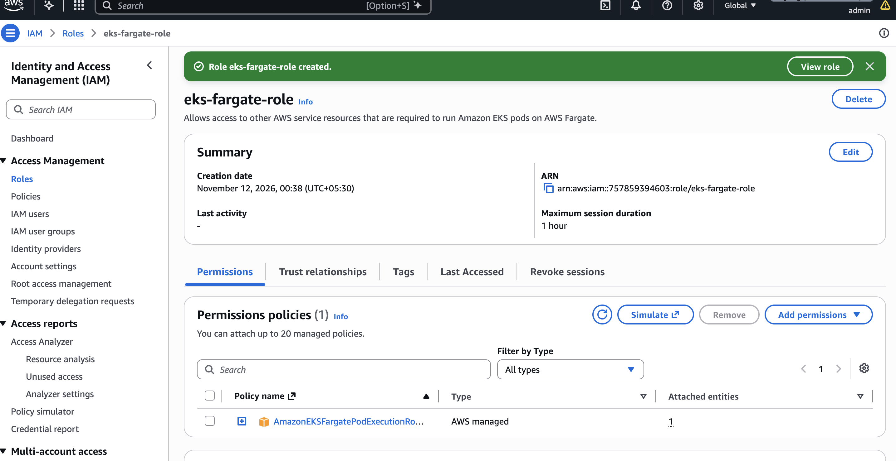
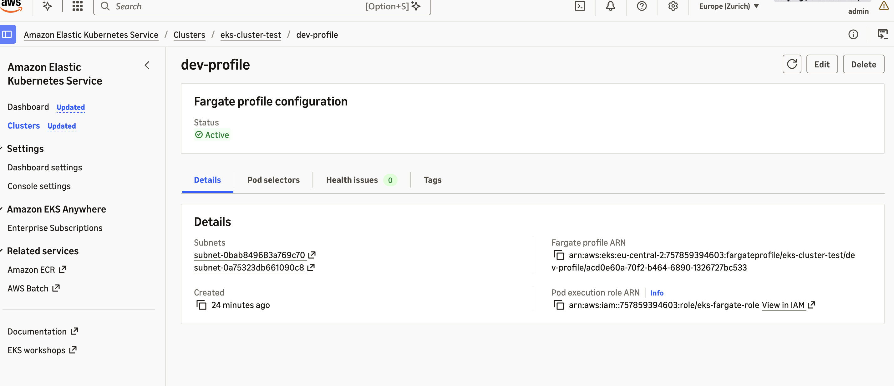
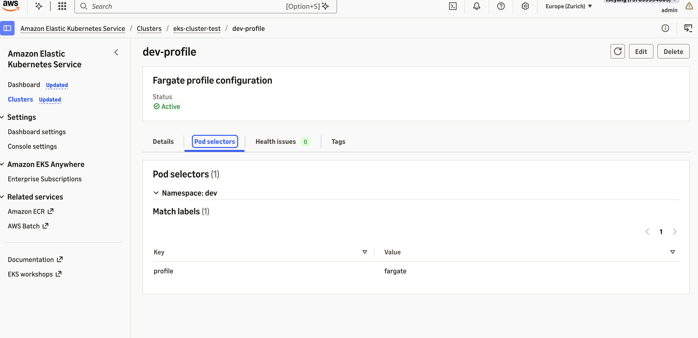
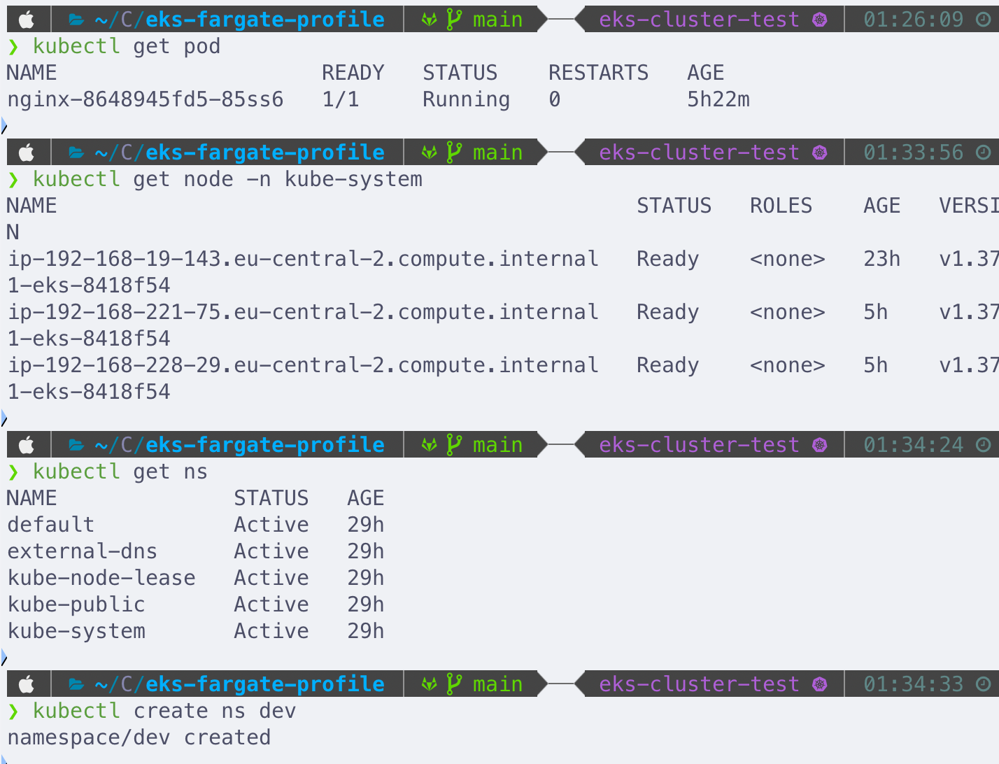
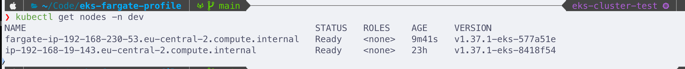
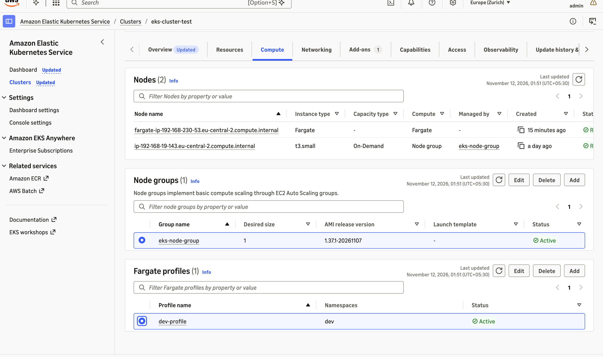

# EKS Cluster with Fargate

## Description

This project shows how to run workloads on an Amazon EKS cluster using AWS Fargate. We create a Fargate IAM role (pod execution role) and a Fargate profile, then deploy an example application whose pods are scheduled onto Fargate.

Fargate is serverless, so there are no EC2 instances in our AWS account. AWS manages the compute resources for us. Fargate runs 1 pod per virtual machine.

Main limitations:

- You cannot deploy stateful applications on Fargate (EBS volumes are not supported).
- DaemonSets are not supported. If you need a daemon (e.g. logging or monitoring agents), run it as a sidecar container in the pod instead.
- Privileged containers are not supported.

## Technologies Used

Kubernetes, AWS EKS, AWS Fargate

## Prerequisites

- An existing EKS cluster (in this demo: `eks-cluster-test`)
- `kubectl` configured to talk to the cluster
- An `nginx.yaml` manifest (example below)

## Steps

### 1. Create the Fargate IAM Role

In the IAM console, create a new role:

- **Use case:** `EKS` → `EKS - Fargate pod`
  (allows access to other AWS service resources required to run Amazon EKS pods on AWS Fargate)
- **Permissions policy:** preselected by AWS (`AmazonEKSFargatePodExecutionRolePolicy`)
- **Role name:** `eks-fargate-role`
- Click **Create role**



### 2. Create the Fargate Profile

A Fargate profile defines a rule that specifies **which pods use Fargate** when they are launched.

Go to **Amazon Elastic Kubernetes Service → Clusters → `eks-cluster-test` → Compute → Add Fargate profile**

| Setting | Value |
|---|---|
| Name | `dev-profile` |
| Pod execution role | `eks-fargate-role` |
| Subnets | The VPC subnets used to schedule pods (pods on Fargate get their IP address from our subnet range). Only **private** subnets are supported. |
| Pod selectors → Namespace | `dev` |
| Pod selectors → Match labels | `profile: fargate` |

> The match labels specify which pods from the `dev` namespace run on Fargate using this profile. Pods in `dev` **without** this label will not be scheduled on Fargate.

Click **Create**.

Profile details (subnets, pod execution role, status `Active`):



Pod selectors (namespace `dev`, label `profile: fargate`):



### 3. Deploy an Application Through Fargate

Once the profile status is **Active**, we can deploy pods to Fargate.

Check the cluster and create the namespace:

```bash
kubectl get pod
kubectl get nodes
kubectl get ns
kubectl create ns dev
```



Example `nginx.yaml` (note the `dev` namespace and the `profile: fargate` label, which must match the Fargate profile selector):

```yaml
apiVersion: apps/v1
kind: Deployment
metadata:
  name: nginx
  namespace: dev
spec:
  selector:
    matchLabels:
      app: nginx
      profile: fargate
  replicas: 1
  template:
    metadata:
      labels:
        app: nginx
        profile: fargate
    spec:
      containers:
      - name: nginx
        image: nginx
        ports:
        - containerPort: 80
---
apiVersion: v1
kind: Service
metadata:
  name: nginx
  namespace: dev
  labels:
    app: nginx
spec:
  ports:
  - name: http
    port: 80
    protocol: TCP
    targetPort: 80
  selector:
    app: nginx
  type: LoadBalancer
```

Apply it and watch the pods start:

```bash
kubectl apply -f nginx.yaml
kubectl get pods -n dev -w
kubectl get nodes -n dev
```

Each pod gets its own Fargate node (named `fargate-ip-...`).



The Fargate node also shows up in the console under **Compute**, next to the EC2 node group and the Fargate profile:



### 4. Clean Up

First delete the Kubernetes resources, so the load balancer created by the Service is removed too:

```bash
kubectl delete -f nginx.yaml
```

Then, from **EKS → Clusters → `eks-cluster-test` → Compute**, delete in this order:

1. Node group
2. Fargate profile (`dev-profile`)
3. EKS cluster (`eks-cluster-test`)

Optionally, also delete the `eks-fargate-role` IAM role.